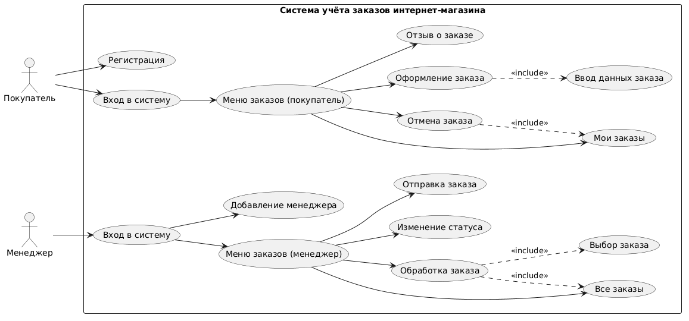

# Online Store Order Tracker

Учебный проект: система учёта заказов в интернет-магазине.
Разрабатывается пошагово в рамках лабораторных работ по дисциплине «Информатика».

На данном этапе в репозитории настроено окружение, залита базовая структура проекта и заготовка программы («Hello, World!»). Логика системы будет добавляться в следующих лабораторных работах.

## Содержание

- [Online Store Order Tracker](#online-store-order-tracker)
  - [Содержание](#содержание)
  - [Описание проекта](#описание-проекта)
  - [Пользователи и роли](#пользователи-и-роли)
  - [Основные функции](#основные-функции)
  - [Архитектура](#архитектура)
  - [Use Case диаграмма](#use-case-диаграмма)
  - [Структура репозитория](#структура-репозитория)
  - [Сборка и запуск](#сборка-и-запуск)

## Описание проекта

Тема работы — заказы в интернет-магазине: как покупатель их создаёт, а менеджер обрабатывает и доводит до отправки. Система хранит состав заказа (товары и количество), адрес доставки, способ оплаты, статус заказа, менеджера, который его ведёт, и отзыв, который покупатель оставляет после получения товара.

**Цели системы:**

- все заказы собраны в одном месте, а не разбросаны по почте и звонкам;
- покупатель в любой момент видит, на каком этапе его заказ;
- менеджеры не путаются, кто какой заказ уже взял в работу;
- новые заказы быстрее находят и обрабатывают;
- остаётся история заказов и отзывов покупателей. 

## Пользователи и роли

| Роль | Возможности |
|---|---|
| **Покупатель** | регистрация, оформление заказа, просмотр статуса своих заказов, отмена заказа (пока не отправлен), отзыв после получения товара |
| **Менеджер** | просмотр всех заказов, обработка заказа, изменение статуса, отправка заказа, добавление новых менеджеров |

## Основные функции

1. Вход и регистрация с учётом роли (покупатель / менеджер).
2. Оформление заказа: товары, адрес доставки, способ оплаты.
3. Автоматическое присвоение заказу номера и статуса `Новый`.
4. Просмотр заказов (покупатель — своих, менеджер — всех сразу).
5. Взятие заказа в обработку и изменение статуса.
6. Отмена заказа покупателем, если его ещё не отправили.
7. Отзыв покупателя после доставки.

## Архитектура

Классическая трёхуровневая архитектура:

- **Presentation Layer** — мини-приложение: каталог, оформление заказа, отдельная панель для менеджера с очередью заказов;
- **Business Logic Layer** — бэкенд на PHP: проверка данных заказа, смена статусов, права доступа;
- **Data Layer** — база данных MySQL с таблицами Users, Orders, OrderItems, Products и историей статусов заказа.

## Use Case диаграмма

Диаграмма построена в PlantUML, исходный файл — [`docs/diagrams/usecase.puml`](docs/diagrams/usecase.puml).



Два актёра — **Покупатель** и **Менеджер**. Связи `«include»` показывают четыре обязательные связки: оформление заказа включает ввод его данных, отмена заказа включает просмотр своих заказов, а обработка заказа менеджером включает просмотр всех заказов и выбор конкретного заказа.

## Структура репозитория

```
online-store-tracker/
├── .git/
├── .gitignore
├── README.md
├── src/
│   └── index.php          # точка входа в программу
└── docs/
    └── diagrams/
        ├── usecase.puml    # исходник диаграммы (PlantUML)
        └── usecase.png     # сгенерированное изображение
```

## Сборка и запуск

Требуется PHP (например, через встроенный сервер разработки).

```bash
php -S localhost:8000 -t src
```

Откройте `http://localhost:8000` в браузере — должно появиться `Hello, World!`.
